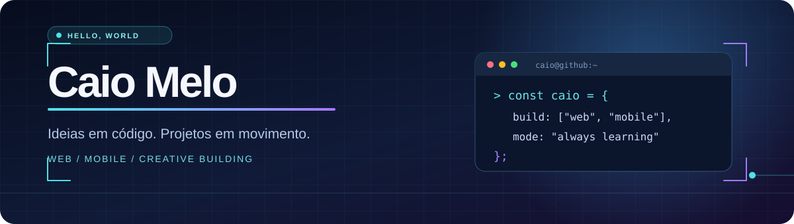

  
    
  
    
  <a href="https://github.com/CaioNMelo?tab=repositories"><strong>⌁ Explorar projetos</strong></a> &nbsp;·&nbsp; <a href="mailto:cnnmelo@gmail.com"><strong>✉ Entrar em contato</strong></a>

 

## 👋 Sobre mim

Sou **Caio Melo**. Gosto de transformar ideias em projetos digitais e explorar diferentes formas de construir para **web e mobile**. Aqui você encontra interfaces, aplicativos e experimentos que mostram minha evolução como desenvolvedor.

## ⚡ Tecnologias

  <code>JavaScript</code> &nbsp; <code>TypeScript</code> &nbsp; <code>React</code> &nbsp; <code>Flutter</code> &nbsp; <code>Dart</code> &nbsp; <code>Python</code> &nbsp; <code>HTML5</code> &nbsp; <code>CSS3</code>

## 🐍 A cobrinha dos commits

  <picture>
    <source media="(prefers-color-scheme: dark)" srcset="https://raw.githubusercontent.com/CaioNMelo/CaioNMelo/output/github-snake-dark.svg" />
    <source media="(prefers-color-scheme: light)" srcset="https://raw.githubusercontent.com/CaioNMelo/CaioNMelo/output/github-snake.svg" />
    
  </picture>

## 📊 Meu GitHub em números

  
  
   
  

  

  

## 🚀 Projetos em destaque

| Projeto | O que você encontra | Stack |
| :--- | :--- | :--- |
| [**BookShelf**](https://github.com/CaioNMelo/BookShelf) | App de notícias com busca, filtros e leitura salva no dispositivo. | Flutter · Dart · SQLite |
| [**Digital Pet Badge**](https://github.com/CaioNMelo/digital-pet-badge) | Projeto de interface web. | React · TypeScript · Tailwind CSS |
| [**Academia Vital Ativa**](https://github.com/CaioNMelo/academiafinal) | Site para academia. | HTML · CSS |

## 🌐 Vamos conectar

  <a href="mailto:cnnmelo@gmail.com">Email</a> &nbsp;·&nbsp; <a href="https://www.instagram.com/caiomelo8580/">Instagram</a> &nbsp;·&nbsp; <a href="https://github.com/CaioNMelo">GitHub</a>

 

  Construindo, aprendendo e compartilhando — um commit de cada vez.

